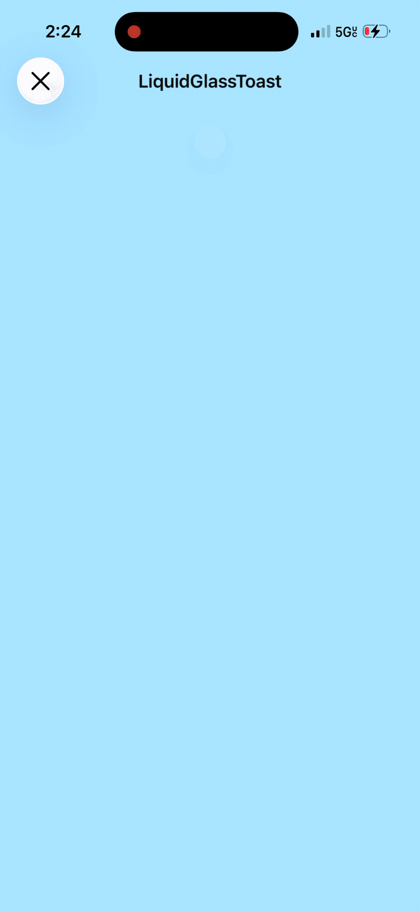

# ``Beautiful_iOS_Components/LiquidGlassToast``

A liquid-glass toast inspired by a water droplet hitting glass.

## Overview

LiquidGlassToast is designed to feel like a droplet of water lands on the screen, spreads,
then gently recoils—mirroring how water behaves when it falls or spills.

- **Drop**: `dropTime` controls the initial fade/drop-in as the droplet arrives.
- **Spread with overshoot**: `expansionDuration` and `overshootPercent` create a quick outward expansion with a soft overshoot.
- **Recoil**: `contractionDuration` brings the width back toward equilibrium with a gentle ease.
- **Settle**: `holdDuration` optionally pauses at rest before dismiss.
- **Dismiss**: `closeDuration` smooths the collapse and fade-out.

The surface uses a glass material so the toast reads clearly while preserving the liquid aesthetic. Enable tinting to add a hue to the glass for visual emphasis.

## Layout and lifecycle

Give the toast a bounded container width, typically in an overlay with horizontal padding.
It fills that available width for layout, centers the glass surface, and wraps long messages
at the current Dynamic Type size. Short messages retain the pill shape; multiline messages
use rounded corners so their text stays inside the glass surface. Expansion never exceeds
the container width.

Changing the message or removing the view cancels its pending animation and dismissal work.
Clearing an already-presented message closes it; an initially empty message is not presented.
`holdDuration: nil` means no additional settling pause, not an indefinite presentation.

With Reduce Motion enabled, the message appears without the width and opacity animations.
The opening and settling durations still contribute to its reading time, and tapping to
dismiss does not animate.

## Demo

@Video(source: "Media/liquidglass_toast.mp4", poster: "Media/liquidglass_poster.png")

## Topics

### Essentials

- ``LiquidGlassToast``
